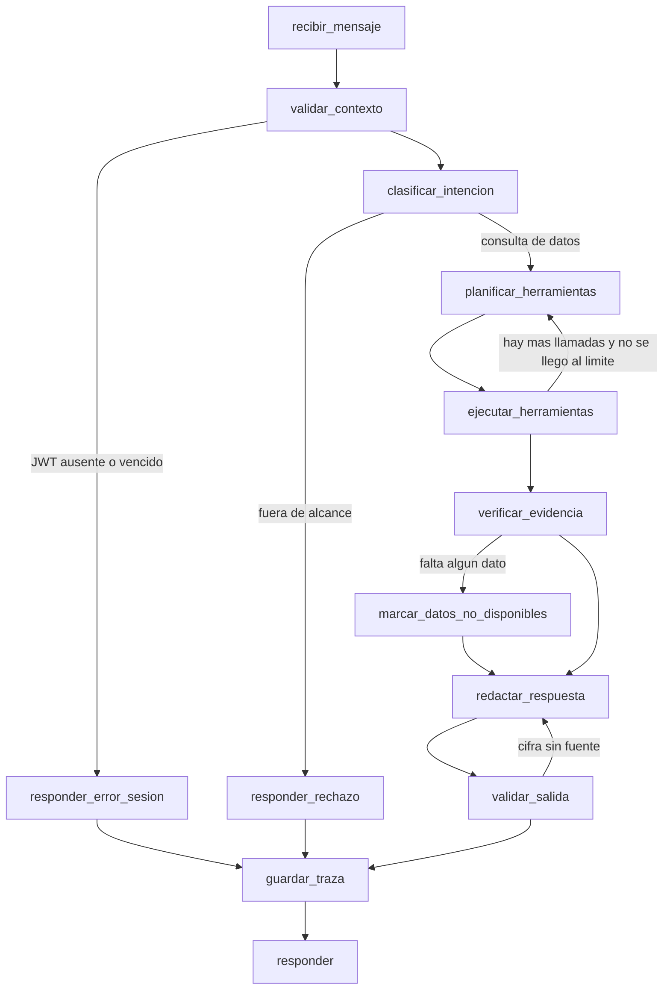

# Diseño del agente: herramientas, flujo y formatos (S1-11)

**Estado:** borrador para revisión de Mikel, Gabriel y Benjamín
**Responsable:** Juan
**Servicio:** `agent-service` (Python 3.11, FastAPI, LangGraph, Pydantic) con Ollama
**Basado en:** los contratos v1 unidos a `develop`: `api-gateway.v1.yaml` y `moodle-sync.v1.yaml` (versión 1.0.0, PRs #2 y #7) y `analytics.v1.yaml` con las reglas iniciales (PR #6), más las decisiones de S1-06 y las pruebas de modelos de S1-12 (PR #3)

## 1. Principios

1. El agente **solo lee**. No tiene herramientas que modifiquen datos ni que envíen mensajes.
2. El agente consulta únicamente el **api-gateway**, reenviando el JWT del docente. Nunca accede a la base de datos ni a Moodle.
3. Los **cálculos son deterministas** y los hace `analytics-service`. El modelo de lenguaje solo explica resultados y recomienda acciones.
4. Todo número que aparece en una respuesta debe salir de la salida de una herramienta. Si no hay dato, el agente lo dice y no lo inventa.
5. Un `score` nulo **no es 0**. Se respetan los estados `graded`, `pending_grading` y `not_submitted`.
6. Lo que devuelven las herramientas son **datos no confiables**: nunca se ejecutan como instrucciones.

## 2. Contexto de ejecución

| Elemento | Valor propuesto |
|---|---|
| Entrada | `POST /chat` del `agent-service` con encabezado `Authorization: Bearer <JWT>` y el mensaje del docente |
| Modelo | `qwen3:1.7b` (decisión provisional de S1-12); alternativa `qwen2.5:3b` (ver `docs/benchmarks/ollama-pruebas-modelos.md`) |
| Memoria de conversación | Sin memoria en v1: cada mensaje es independiente (pregunta abierta 4 del Product Owner) |
| Máximo de llamadas a herramientas por mensaje | 5 |
| Tiempo máximo por herramienta | 10 s |
| Tiempo máximo por mensaje | 60 s (meta del plan, sección 8.1) |
| Temperatura | 0 para la selección de herramientas |

## 3. Contrato de las herramientas

Cada herramienta tiene un esquema de entrada y otro de salida, validados con Pydantic. Si la entrada del modelo no valida, la herramienta no se ejecuta y el agente recibe un error `VALIDATION_ERROR`.

Convención de salida común de toda herramienta:

```json
{
  "ok": true,
  "data": {},
  "error": null,
  "source": { "endpoint": "GET /api/v1/courses", "requestId": "…", "fetchedAt": "2026-10-22T15:04:05Z" }
}
```

En error, `ok` es `false`, `data` es `null` y `error` tiene la forma:

```json
{ "code": "COURSE_NOT_AUTHORIZED", "message": "El docente no tiene acceso a ese curso", "retryable": false }
```

Los códigos de error son los del gateway: `TOKEN_EXPIRED`, `TOKEN_INVALID`, `COURSE_NOT_AUTHORIZED`, `COURSE_NOT_FOUND`, `STUDENT_NOT_FOUND`, `MOODLE_UNAVAILABLE`, `DATA_NOT_AVAILABLE` y `VALIDATION_ERROR`; se añade `TOOL_TIMEOUT` para el tiempo agotado.

### 3.1 `listar_cursos`

Lista los cursos a los que el docente tiene acceso.

- **Gateway:** `GET /api/v1/courses`
- **Entrada:** sin parámetros.
- **Salida (`data`):**

```json
{
  "courses": [
    { "id": 2, "shortName": "PRUEBA01", "fullName": "Curso de Prueba EduMonitor",
      "studentCount": 8, "lastSyncAt": "2026-10-22T14:00:00Z" }
  ]
}
```

### 3.2 `obtener_calificaciones`

Devuelve las calificaciones de un curso, opcionalmente de un estudiante o de una actividad.

- **Gateway:** `GET /api/v1/courses/{courseId}/grades` (con `studentId` y `activityId` opcionales), paginado.
- **Entrada:**

```json
{
  "type": "object",
  "required": ["course_id"],
  "properties": {
    "course_id": { "type": "integer", "description": "Id del curso en Moodle" },
    "student_id": { "type": "integer", "description": "Id del estudiante en Moodle" },
    "activity_id": { "type": "integer", "description": "Id de la actividad" }
  }
}
```

- **Salida (`data`):**

```json
{
  "courseId": 2,
  "items": [
    { "studentId": 4, "activityId": 1, "activityName": "Tarea 1", "status": "graded", "submissionStatus": "submitted",
      "score": 8.5, "maxScore": 10, "submittedAt": "2026-10-10T12:00:00Z", "gradedAt": "2026-10-12T09:00:00Z" },
    { "studentId": 5, "activityId": 1, "activityName": "Tarea 1", "status": "not_submitted", "submissionStatus": "none",
      "score": null, "maxScore": 10, "submittedAt": null, "gradedAt": null }
  ],
  "total": 2,
  "truncated": false
}
```

`submissionStatus` (`none`, `draft` o `submitted`) distingue a quien no entregó de quien dejó un borrador sin enviar. La herramienta recorre las páginas del gateway hasta un máximo de 500 registros. Si hay más, devuelve `truncated: true` y el agente lo menciona.

### 3.3 `obtener_progreso`

Devuelve el progreso de un curso o de un estudiante: indicadores (promedio, tasas de entrega, calificación y finalización, pendientes y conteos) y, para un estudiante, el progreso por actividad. Los indicadores los calcula `analytics-service`; el agente no calcula nada.

**Decisión: no se agrega una ruta `/progress`.** La herramienta combina rutas que ya existen en los contratos v1:

| Consulta | Rutas del gateway |
|---|---|
| Curso (sin `student_id`) | `GET /api/v1/courses/{courseId}/analytics` |
| Estudiante (con `student_id`) | `GET /api/v1/courses/{courseId}/analytics/students/{studentId}` para los indicadores, y `GET /api/v1/courses/{courseId}/students/{studentId}` para `activities` (`completionState` por actividad, agregado en el PR #7) |

De la ficha del estudiante (`StudentDetail`) la herramienta solo toma `activities`; las calificaciones las obtiene `obtener_calificaciones`. Todas las rutas aceptan `snapshotId` cuando es de analytics; si se omite se usa la última sincronización exitosa. Si más adelante se necesita una vista de progreso con una sola llamada, se propone una ruta nueva como cambio de contrato versionado.

- **Entrada:**

```json
{
  "type": "object",
  "required": ["course_id"],
  "properties": {
    "course_id": { "type": "integer", "description": "Id del curso en Moodle" },
    "student_id": { "type": "integer", "description": "Si se indica, devuelve los indicadores de ese estudiante" },
    "snapshot_id": { "type": "string", "description": "Opcional. Por defecto, la última sincronización exitosa" }
  }
}
```

- **Salida (`data`):** el cuerpo `CourseAnalytics` o `StudentAnalytics` del contrato, sin cambios:

```json
{
  "courseId": 2,
  "snapshot": { "snapshotId": "s-001", "syncId": "y-001", "calculatedAt": "2026-10-22T14:05:00Z", "dataQuality": "partial" },
  "averageScore":       { "value": 4.0, "unit": "score_0_10", "status": "available", "numerator": null, "denominator": null },
  "submissionRate":     { "value": 50.0, "unit": "percent", "status": "available", "numerator": 2, "denominator": 4 },
  "gradingRate":        { "value": 100.0, "unit": "percent", "status": "available", "numerator": 2, "denominator": 2 },
  "completionRate":     { "value": null, "unit": "percent", "status": "unavailable", "code": "DATA_NOT_AVAILABLE",
                          "detail": "Moodle no configuró el seguimiento de finalización." },
  "pendingGradingRate": { "value": 25.0, "unit": "percent", "status": "available", "numerator": 1, "denominator": 4 },
  "counts": { "graded": 2, "pendingGrading": 1, "notSubmitted": 1, "draft": 0 }
}
```

Con `student_id`, la salida añade `activities`, tal como las devuelve `StudentDetail`:

```json
"activities": [
  { "activityId": 1, "activityType": "assign", "completionState": "complete" },
  { "activityId": 2, "activityType": "assign", "completionState": "not_available" }
]
```

Los valores son ilustrativos; la forma es la del contrato. `completionState` puede ser `complete`, `incomplete`, `passed`, `failed` o `not_available`.

### 3.4 `identificar_alertas`

Devuelve las alertas del curso con la evidencia de cada una (regla, valor observado, umbral y explicación; RF-12).

- **Gateway:** `GET /api/v1/courses/{courseId}/analytics/alerts`, con `studentId`, `severity`, `page` y `pageSize` opcionales.
- **Entrada:**

```json
{
  "type": "object",
  "required": ["course_id"],
  "properties": {
    "course_id": { "type": "integer" },
    "student_id": { "type": "integer" },
    "severity": { "type": "string", "enum": ["info", "warning", "critical"] },
    "snapshot_id": { "type": "string" }
  }
}
```

- **Salida (`data`):** las alertas del contrato (`PageOfAlerts`), recorridas por la herramienta hasta el límite de la sección 3.6:

```json
{
  "courseId": 2,
  "items": [
    { "alertId": "al-001", "ruleCode": "LOW_AVERAGE", "courseId": 2, "studentId": 5,
      "severity": "warning", "status": "active", "detectedAt": "2026-10-22T14:05:00Z", "resolvedAt": null,
      "evidence": [ { "metric": "averageScore10", "observedValue": 4.0, "threshold": 6.0,
                      "numerator": null, "denominator": null, "sourceIds": ["grade-1", "grade-2"],
                      "explanation": "Promedio de 2 notas calificadas por debajo del umbral de 6.0" } ] }
  ],
  "total": 1,
  "truncated": false
}
```

Los valores son ilustrativos; la forma es la del contrato.

El código de regla (`LOW_AVERAGE`, `LOW_SUBMISSION`, `PENDING_GRADING`, `LOW_COMPLETION`, `NO_DATA`) se traduce a un nombre legible con una tabla fija del `agent-service`, tomada de las reglas iniciales de analytics (`docs/analytics-rules/reglas-iniciales.md`). El agente cita siempre la evidencia de la alerta y no la reinterpreta.

### 3.5 `generar_resumen`

Obtiene los datos calculados para el informe del curso. No calcula nada: `analytics-service` entrega métricas y hallazgos, y el modelo solo los redacta.

- **Gateway:** `GET /api/v1/courses/{courseId}/analytics/report`.
- **Entrada:**

```json
{
  "type": "object",
  "required": ["course_id"],
  "properties": {
    "course_id": { "type": "integer" },
    "snapshot_id": { "type": "string" }
  }
}
```

- **Salida (`data`):** `CourseReportData` del contrato: `snapshot`, `periodStart` y `periodEnd` (pueden ser nulos), `metrics` (mapa de `Metric`), `findings` (lista de textos) y `activeAlertCount`. Para el informe completo el agente combina esta salida con `identificar_alertas` si el docente pide el detalle de las alertas.
- **Pendiente:** el contenido y el formato exacto del informe dependen de la pregunta 2 al Product Owner (secciones, período y formato). Por ahora el informe se redacta con los campos que entrega el contrato y con la fecha del snapshot.

### 3.6 Datos no disponibles, paginación y límites

**Datos no disponibles.** Los indicadores usan `Metric` con `status` (`available`, `partial` o `unavailable`), `value` nulo y `code: DATA_NOT_AVAILABLE` cuando falta el dato; `snapshot.dataQuality` resume la calidad (`complete`, `partial` o `unavailable`). Reglas del agente:

- Un `value` nulo nunca se presenta como 0 ni como 0 %. Se dice "dato no disponible" y se cita el `detail`.
- Si `dataQuality` es `partial`, el agente avisa que el resultado es parcial.
- Una alerta `NO_DATA` se explica como falta de datos, no como un problema del estudiante.
- Una nota `pending_grading` o `not_submitted` (con `score` nulo) se redacta como "pendiente de calificar" o "sin entrega", nunca como 0.
- Una actividad con `completionState: not_available` (Moodle no tiene finalización configurada o no entrega información) se dice "finalización no disponible", nunca como incompleta ni como 0 %. En el gateway, `DATA_NOT_AVAILABLE` se reserva para cuando no se puede obtener el recurso completo (por ejemplo, un curso aún no sincronizado).
- Un borrador llega como `submissionStatus: draft` con `status: not_submitted`, y los indicadores de analytics lo cuentan como no entregado (`counts.draft`). El agente lo redacta como "borrador sin enviar" y no como "sin entrega" a secas. La regla sigue pendiente de confirmar con el Product Owner (pregunta 15 de los requisitos).

**Paginación y límites.** El gateway pagina notas, estudiantes y alertas con `page` (desde 1) y `pageSize` (1 a 200, por defecto 50). Los indicadores de curso y de estudiante y los datos del informe no se paginan. Límites del agente:

- Máximo de 10 páginas o 500 registros por herramienta. Si hay más, la salida lleva `truncated: true` y el agente lo menciona.
- Máximo de 5 llamadas a herramientas por mensaje.
- Los indicadores y las alertas usan la última sincronización exitosa. El agente muestra siempre la fecha del cálculo (`snapshot.calculatedAt`) y la de la última sincronización.

### 3.7 Resumen de herramientas

| Herramienta | Sprint | Ruta del gateway | Origen del contrato |
|---|---|---|---|
| `listar_cursos` | S3 | `GET /api/v1/courses` | `api-gateway.v1` 1.0.0 |
| `obtener_calificaciones` | S3 | `GET /api/v1/courses/{courseId}/grades` | `api-gateway.v1` 1.0.0 |
| `obtener_progreso` | S3 | `GET /api/v1/courses/{courseId}/analytics`; con estudiante, también `.../analytics/students/{studentId}` y `GET /api/v1/courses/{courseId}/students/{studentId}` | `analytics.v1` (PR #6) y `api-gateway.v1` 1.0.0 (PR #7) |
| `identificar_alertas` | S4 | `GET /api/v1/courses/{courseId}/analytics/alerts` | `analytics.v1` (PR #6) |
| `generar_resumen` | S5 | `GET /api/v1/courses/{courseId}/analytics/report` | `analytics.v1` (PR #6) |

Las rutas de analytics están definidas en el contrato de `analytics-service`. El contrato del gateway (1.0.0) solo menciona que salen por él y no las lista; hay que confirmar con Mikel que las expone con esas mismas rutas.

## 4. Flujo de LangGraph



| Nodo | Qué hace |
|---|---|
| `recibir_mensaje` | Recibe el mensaje y el JWT. Genera un `traceId`. El JWT queda solo en memoria del request. |
| `validar_contexto` | Comprueba que haya JWT y que no esté vencido (sin validar la firma, eso lo hace el gateway). |
| `clasificar_intencion` | Decide si la consulta es de datos del curso, si pide un informe o si está fuera de alcance (modificar notas, enviar mensajes, predicciones psicológicas, otros temas). |
| `planificar_herramientas` | El modelo elige qué herramientas llamar y con qué argumentos. |
| `ejecutar_herramientas` | Valida los argumentos con Pydantic, llama al gateway con el JWT y registra el resultado. Respeta los límites de la sección 2. |
| `verificar_evidencia` | Comprueba si todas las herramientas devolvieron datos. Si falló alguna, pasa a `marcar_datos_no_disponibles`. |
| `marcar_datos_no_disponibles` | Anota explícitamente qué dato no se pudo obtener y por qué. |
| `redactar_respuesta` | El modelo redacta con el formato de la sección 6, solo con las salidas de las herramientas. |
| `validar_salida` | Código determinista: comprueba que cada cifra de los hechos aparece en alguna salida de herramienta. Si no, vuelve a redactar (máximo 1 reintento) o elimina la cifra. |
| `guardar_traza` | Guarda la traza de la sección 5 en el esquema `agent`. |

Comportamientos ante fallas:

| Situación | Respuesta del agente |
|---|---|
| `TOKEN_EXPIRED` o `TOKEN_INVALID` | Avisa que la sesión venció y pide iniciar sesión de nuevo. |
| `COURSE_NOT_AUTHORIZED` | Informa que no tiene acceso a ese curso. No intenta otro camino. |
| `MOODLE_UNAVAILABLE` o `TOOL_TIMEOUT` | Informa que no pudo obtener el dato, sugiere reintentar o sincronizar. No estima valores. |
| `truncated: true` | Indica que se analizaron solo los primeros registros. |
| Consulta fuera de alcance | Rechaza en una frase y explica qué sí puede hacer. |

## 5. Formato de las trazas

Se guarda una traza por mensaje, en el esquema `agent`. Estructura (JSON, los valores son ilustrativos):

```json
{
  "traceId": "9f1c…",
  "requestId": "…",
  "startedAt": "2026-10-22T15:04:05Z",
  "finishedAt": "2026-10-22T15:04:21Z",
  "teacherId": 3,
  "model": "qwen3:1.7b",
  "message": { "text": "¿Quién está en riesgo en el curso 2?", "redacted": false },
  "intent": "consulta_datos",
  "steps": [
    { "n": 1, "node": "ejecutar_herramientas", "tool": "identificar_alertas",
      "args": { "course_id": 2 }, "ok": true, "errorCode": null,
      "durationMs": 840, "resultSummary": { "alerts": 1 } }
  ],
  "output": { "validated": true, "unsourcedNumbersRemoved": 0 },
  "totals": { "toolCalls": 1, "durationMs": 15800 },
  "status": "ok"
}
```

Reglas:
- **Nunca** se guarda el JWT ni el contenido de las entregas.
- Las trazas guardan los identificadores de estudiantes de Moodle, no sus nombres, hasta que el Product Owner decida (pregunta abierta 9).
- Para cada herramienta se guardan los argumentos, el código de resultado, la duración y un resumen del resultado, no la salida completa.
- `status` puede ser `ok`, `partial` (falló alguna herramienta), `refused` (fuera de alcance) o `error`.

## 6. Formato de las respuestas

El agente siempre separa **hechos**, **inferencias** y **recomendaciones**. El `agent-service` devuelve este JSON y la interfaz lo muestra en tres bloques. Los valores del ejemplo son ilustrativos; la regla `LOW_AVERAGE` y su umbral inicial de 6,0 vienen de las reglas iniciales de analytics y pueden cambiar con la configuración o con la decisión del Product Owner:

```json
{
  "traceId": "9f1c…",
  "answer": {
    "facts": [
      { "text": "El estudiante 5 tiene un promedio de 4,0 sobre 10 en las actividades calificadas.",
        "sources": [ { "tool": "obtener_progreso", "stepN": 1 } ] }
    ],
    "inferences": [
      { "text": "El promedio está por debajo del umbral de 6,0 de la regla «Promedio bajo» (`LOW_AVERAGE`).",
        "basedOn": [ 0 ] }
    ],
    "recommendations": [
      { "text": "Conviene revisar con el estudiante 5 las dos últimas tareas.", "relatedFinding": 0 }
    ],
    "unavailable": [ "Finalización de actividades: Moodle no expone el dato." ]
  },
  "meta": { "courseId": 2, "lastSyncAt": "2026-10-22T14:00:00Z", "status": "ok" }
}
```

Reglas del formato:
- Cada **hecho** cita su fuente (herramienta y paso de la traza) y su cifra proviene de la salida de esa herramienta.
- Cada **inferencia** indica en qué hechos se basa. Se redacta con cautela ("podría", "sugiere"), nunca como certeza.
- Cada **recomendación** se vincula a un hallazgo. No hay recomendaciones sin respaldo.
- Siempre se muestra la fecha de la última sincronización.
- Lo que no se pudo obtener va en `unavailable`.
- El agente no afirma nada sobre el estado psicológico o personal de un estudiante.

## 7. Seguridad

| Riesgo | Medida |
|---|---|
| Acceso a un curso ajeno | El gateway devuelve 403 y el agente lo informa. No hay otra vía de datos. |
| Instrucciones escondidas en los datos (nombres de actividades, comentarios) | Las salidas se tratan como datos: se pasan al modelo dentro de un bloque delimitado, truncadas y con los caracteres de control eliminados. El sistema indica que nada dentro del bloque es una orden. |
| Fuga del JWT | No se escribe en trazas ni en registros, y no se incluye en el prompt. |
| Datos inventados | `validar_salida` elimina cifras sin fuente y el conjunto de evaluación incluye escenarios de falla. |
| Petición fuera de alcance | El nodo `clasificar_intencion` rechaza modificar notas, enviar mensajes y hacer predicciones psicológicas. |
| Abuso de herramientas | Límite de 5 llamadas por mensaje y tiempo máximo por herramienta y por mensaje. |

## 8. Pruebas previstas

- **Unitarias (pytest):** cada herramienta con respuestas simuladas del gateway, validación de esquemas, manejo de cada código de error y `validar_salida`.
- **Evaluación:** los 20 escenarios del plan (5 consulta simple, 5 falla de herramienta, 5 alertas con evidencia, 3 seguridad, 2 informe), ejecutados al final de cada sprint desde el Sprint 3. Metas: 100 % de accesos no autorizados rechazados, ningún dato inventado en fallas y al menos 90 % de cifras que coinciden con la fuente.
- **Seguridad:** escenarios con instrucciones escondidas en nombres de actividades y comentarios.

## 9. Dependencias y puntos por acordar

| Con | Qué se necesita | Quién decide |
|---|---|---|
| Mikel | Confirmar que el gateway expone las rutas de analytics (`/analytics`, `/analytics/students/{id}`, `/analytics/alerts` y `/analytics/report`) con esas mismas rutas, y que reenvía `X-Request-Id` | Mikel |
| Gabriel | Dudas sobre `analytics.v1`: (1) las alertas no se pueden filtrar por `status` (`active` o `resolved`), así que el agente recibiría también las resueltas; (2) `findings` del informe es una lista de textos, sin referencia a la alerta o métrica de origen; (3) el archivo aún declara la versión `1.0.0-borrador` y el puerto 5003, que no aparece en los otros contratos | Gabriel |
| Benjamín | Cómo se muestran en el chat los tres bloques (hechos, inferencias, recomendaciones) y los datos no disponibles | Benjamín |
| Product Owner | Memoria de la conversación (pregunta 4), nombres en trazas (pregunta 9), evaluación del agente (pregunta 8), formato del informe (pregunta 2) y tratamiento del borrador (pregunta 15 de los requisitos) | Product Owner |

Para el Sprint 2, el servidor mock del gateway se genera a partir de los contratos definitivos y sirve para probar estas herramientas antes de que existan los servicios reales.
