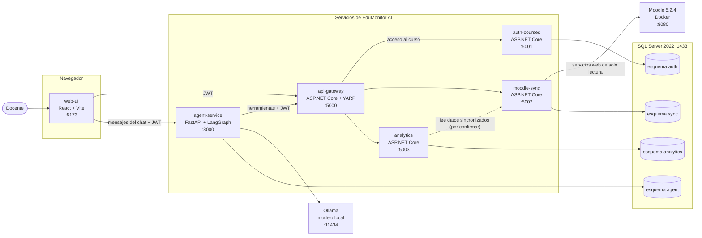
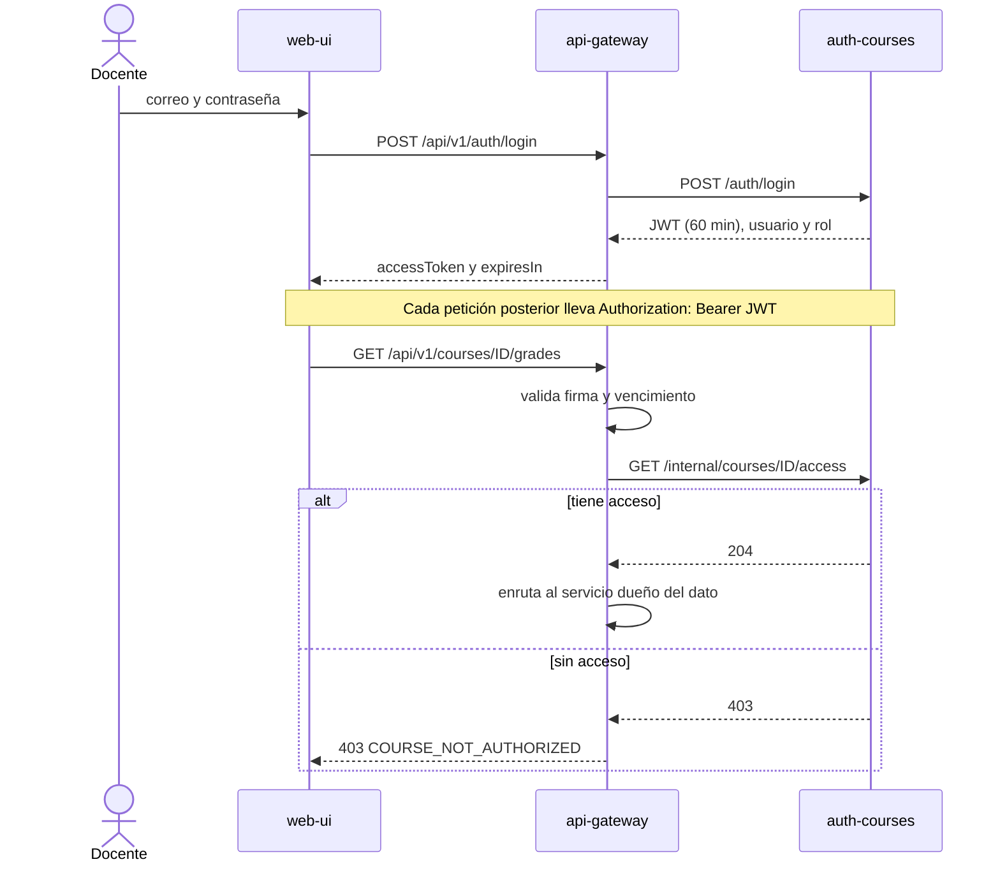
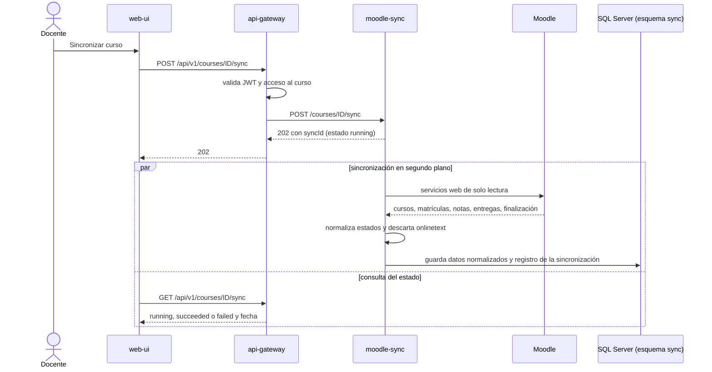
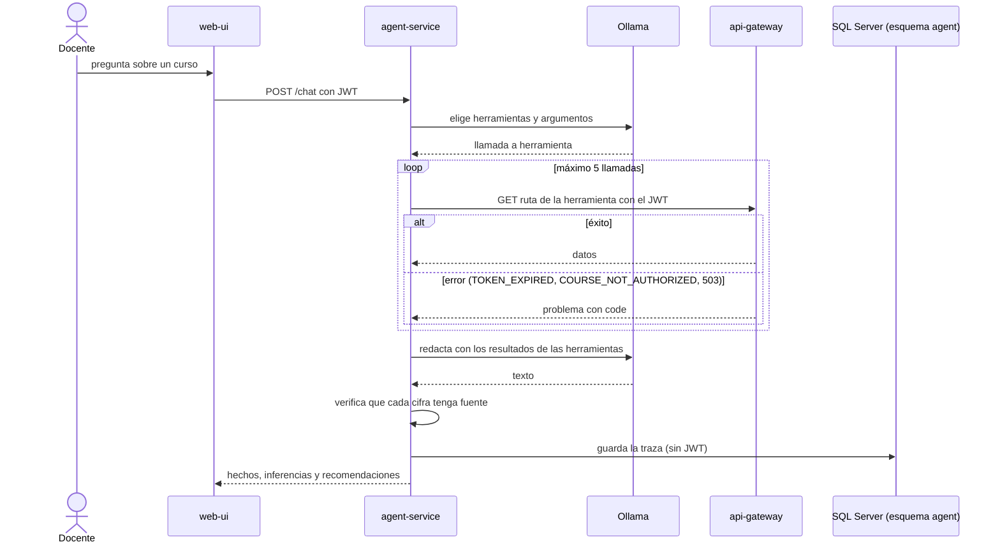

# Arquitectura de EduMonitor AI (S1-16)

**Responsable:** Juan
**Estado:** borrador para revisión del equipo
**Fuente:** plan de proyecto (sección 6), contratos OpenAPI v1 (`docs/contracts/`), modelo de datos (`docs/data-model/diagrama-er.md`), diseño del agente (`docs/agent-design/`) y `.env.example`.

## 1. Principios

- Cinco servicios (`api-gateway`, `auth-courses`, `moodle-sync`, `analytics` y `agent-service`) más la interfaz web. Se comunican solo por API REST.
- Una sola instancia de SQL Server 2022, con un esquema por servicio (`auth`, `sync`, `analytics` y `agent`). Los servicios no comparten tablas: se relacionan por identificadores.
- **El gateway es el único punto de entrada** de la interfaz y del agente hacia los datos.
- **El agente nunca accede a la base de datos ni a Moodle.** Consulta solo por el gateway, con el JWT del docente.
- **Los cálculos son deterministas** y viven en `analytics`. El modelo de lenguaje solo explica y recomienda.
- **Solo lectura sobre Moodle:** el sistema no modifica calificaciones.
- El modelo corre en local (Ollama): ningún dato de estudiantes sale de la máquina.

## 2. Diagrama 1: componentes

Cada flecha es una llamada REST (salvo las indicadas). Los puertos son los de los contratos y de `.env.example`.

Lectura del diagrama:
- La flecha punteada es una dependencia **por confirmar**: el modelo de datos dice que el origen de las calificaciones es `sync` y que analytics no guarda una segunda copia, pero ningún contrato define cómo analytics lee esos datos ni qué dispara el recálculo después de una sincronización (ver sección 8).
- La interfaz habla con dos servicios: el gateway (cursos, notas, sincronización) y `agent-service` (chat). El agente, a su vez, solo llega a los datos por el gateway.

## 3. Diagrama 2: inicio de sesión y acceso por curso

## 4. Diagrama 3: sincronización con Moodle

Reglas de normalización (S1-06 y S1-07): se identifica al estudiante por su id de Moodle, una nota 0 es `graded`, una entrega sin calificar es `pending_grading` y un estudiante sin entrega es `not_submitted`. Un borrador se expone con `submissionStatus: draft`. Una actividad sin finalización configurada se devuelve como `completionState: not_available`, nunca como 0.

## 5. Diagrama 4: consulta al agente

Herramientas y rutas del gateway:

| Herramienta | Ruta |
|---|---|
| `listar_cursos` | `GET /api/v1/courses` |
| `obtener_calificaciones` | `GET /api/v1/courses/{courseId}/grades` |
| `obtener_progreso` | `GET /api/v1/courses/{courseId}/analytics` y, con estudiante, `.../analytics/students/{studentId}` y `GET /api/v1/courses/{courseId}/students/{studentId}` |
| `identificar_alertas` | `GET /api/v1/courses/{courseId}/analytics/alerts` |
| `generar_resumen` | `GET /api/v1/courses/{courseId}/analytics/report` |

El detalle del flujo interno (nodos de LangGraph, trazas y formato de respuesta) está en `docs/agent-design/diseno-agente.md`.

## 6. Servicios y componentes

| Componente | Tecnología | Puerto | Esquema SQL | Responsable | Función |
|---|---|---|---|---|---|
| `web-ui` | React, TypeScript, Vite | 5173 | no usa | Benjamín | Pantallas de login, cursos, dashboard, ficha, alertas, chat e informe |
| `api-gateway` | ASP.NET Core 8, YARP | 5000 | no usa | Mikel | Único punto de entrada. Valida JWT y acceso por curso |
| `auth-courses` | ASP.NET Core 8, EF Core | 5001 | `auth` | Mikel | Inicio de sesión, JWT y cursos autorizados |
| `moodle-sync` | ASP.NET Core 8, EF Core | 5002 | `sync` | Mikel | Cliente de Moodle, sincronización y datos normalizados |
| `analytics` | ASP.NET Core 8, EF Core | 5003 | `analytics` | Gabriel | Indicadores, alertas y datos del informe |
| `agent-service` | Python 3.11, FastAPI, LangGraph, Pydantic | 8000 | `agent` | Juan | Chat, herramientas y trazas |
| Ollama | Ollama (`qwen3:1.7b` provisional) | 11434 | no usa | Juan | Modelo de lenguaje local |
| SQL Server | SQL Server 2022 | 1433 | los cuatro | Gabriel | Una instancia, un esquema por servicio |
| Moodle | Moodle 5.2.4 en Docker | 8080 | propia | Mikel | Origen de los datos académicos |

Los puertos de los servicios de Mikel y de analytics salen de los contratos; `web-ui` (5173), `agent-service` (8000), Moodle (8080), Ollama (11434) y SQL Server (1433) salen de `.env.example`. Todos se alinean con `docker-compose` en el Sprint 2.

## 7. Decisiones técnicas

| Decisión | Motivo |
|---|---|
| Gateway como único punto de entrada | Un solo lugar para validar el JWT y la autorización por curso. |
| El agente consulta por el gateway con el JWT del docente | El agente no tiene credenciales propias ni acceso directo a datos, así que hereda los permisos del docente. |
| Cálculos en `analytics`, no en el modelo | Las cifras son verificables y reproducibles; el modelo no las inventa. |
| Un esquema por servicio en una sola instancia de SQL Server | Aísla los datos de cada servicio sin gestionar cinco bases de datos. |
| Modelo local con Ollama | Los datos de los estudiantes no salen de la máquina. |
| Contratos primero y mocks | Cada integrante trabaja contra un contrato sin esperar al servicio real. |
| Moodle de solo lectura | El sistema no puede alterar calificaciones. |

## 8. Puntos abiertos

| # | Punto | Responsable |
|---|---|---|
| 1 | Cómo lee `analytics` los datos de `sync` y qué dispara el recálculo tras una sincronización (llamada REST a `moodle-sync`, evento u otra opción). No está definido en ningún contrato. | Gabriel y Mikel |
| 2 | El gateway no lista las rutas de analytics en su contrato (O-01 de la revisión cruzada, `docs/reviews/`). | Mikel |
| 3 | `.env.example` pone `ANALYTICS_URL` en el puerto 5002, que es de `moodle-sync`; analytics usa el 5003 en su contrato (O-06). | Gabriel |
| 4 | Aislamiento de red: solo el gateway y el agente deberían estar accesibles desde fuera de la red interna de `docker-compose`. Se refuerza en el Sprint 4. | Gabriel y Mikel |
| 5 | Si `auth-courses` y `moodle-sync` se fusionan en un solo servicio, según el punto de decisión del final del Sprint 2. Este diagrama se actualizaría. | Equipo |
