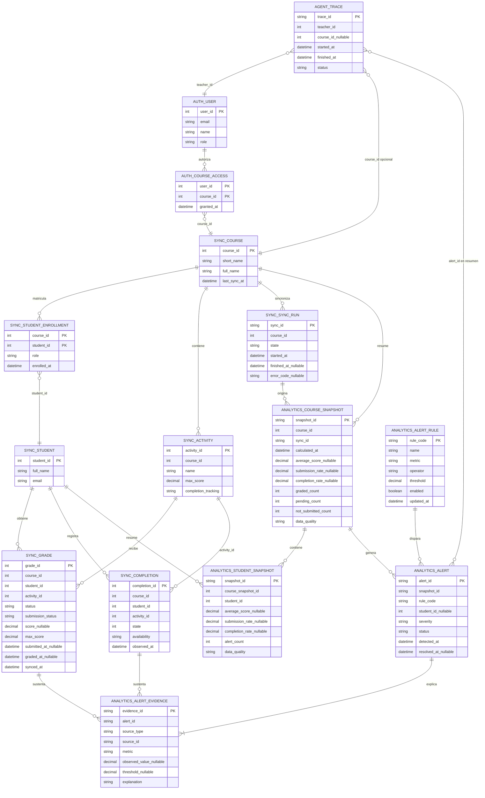

# Modelo entidad-relación de EduMonitor AI (S1-10)

**Responsable:** Gabriel
**Estado:** borrador para revisión
**Fecha:** 2026-10-22
**Fuente:** contratos OpenAPI S1-07, evidencia S1-06 y reglas de analytics S1-09.

## 1. Decisiones del modelo

- La base usa una sola instancia de SQL Server 2022, con un esquema por servicio: `auth`, `sync`, `analytics` y `agent`.
- Los servicios no comparten tablas. Las relaciones entre esquemas se representan mediante identificadores (`course_id`, `student_id`, `activity_id`, `sync_id`, `alert_id`), no mediante claves foráneas entre servicios.
- `student_id` es el `id` estable de Moodle. No se usa `username` como clave.
- El origen de calificaciones es `sync`; analytics guarda resultados calculados y su evidencia, no una segunda copia de las calificaciones.
- La escala funcional del MVP es de 0 a 10. Si una fuente entrega otra escala, se conserva `max_score` y se normaliza a 0–10 antes de calcular indicadores; nunca se comparan puntajes crudos de escalas distintas.
- `score = 0` con `status = graded` es una nota cero válida. `score = NULL` con `pending_grading` o `not_submitted` no se convierte en cero.
- Un borrador de entrega se conserva como metadato técnico (`submission_status = draft`) y se trata como no entregado para los indicadores del MVP.
- El contenido `onlinetext` no pertenece al modelo: se descarta durante la sincronización y tampoco se guarda en logs de analytics.
- La finalización no configurada en Moodle se representa como dato no disponible, nunca como `0 %`.

## 2. Diagrama lógico

## 3. Entidades y responsabilidades

| Esquema | Entidad | Responsabilidad | Regla de retención/dato |
|---|---|---|---|
| `auth` | `user` | Usuario y rol del sistema. | No contiene credenciales en analytics. |
| `auth` | `course_access` | Autorización docente-curso. | El gateway valida el acceso antes de llamar a analytics. |
| `sync` | `course`, `student`, `student_enrollment` | Catálogo y matrícula normalizados desde Moodle. | `student_id` es el id de Moodle. |
| `sync` | `activity`, `grade` | Actividades y calificaciones normalizadas. | `grade` no guarda `onlinetext`; conserva estados y fechas. |
| `sync` | `completion` | Estado de finalización observado en Moodle. | Ausencia de fila puede significar `DATA_NOT_AVAILABLE`, no incompleto. |
| `sync` | `sync_run` | Auditoría técnica de sincronización. | Incluye quién/curso/estado/fechas en la implementación final. |
| `analytics` | `course_snapshot`, `student_snapshot` | Resultados calculados reproducibles por sincronización. | Se pueden recalcular desde `sync` y se guarda la fecha/origen. |
| `analytics` | `alert_rule` | Umbrales configurables sin cambiar código. | Toda regla tiene código estable y versión implícita por `updated_at`. |
| `analytics` | `alert`, `alert_evidence` | Alertas explicables y su evidencia. | Una alerta no existe sin al menos una evidencia. |
| `agent` | `trace` | Trazabilidad del agente. | No guarda JWT, `onlinetext` ni salida completa de Moodle. |

## 4. Integridad y casos especiales

1. Una fila de `sync.grade` es única por `(course_id, student_id, activity_id, sync_id)` o por la clave natural equivalente definida por la migración. La sincronización posterior no debe duplicar la observación vigente.
2. Para calcular promedios solo entran calificaciones `graded` con `score` no nulo y `max_score > 0`.
3. `pending_grading`, `not_submitted` y `draft` se cuentan por separado para explicar el indicador; no se incluyen como ceros en el promedio.
4. Si no existe ninguna calificación `graded`, `average_score` es `NULL` y la calidad es `unavailable`, no `0`.
5. Si ninguna actividad tiene finalización configurada, `completion_rate` es `NULL` y la calidad es `unavailable`.
6. Los resultados de analytics deben identificar el `snapshot_id`, `calculated_at` y `sync_id` para poder rastrear cada cifra hasta la sincronización que la originó.
7. Los nombres y correos de estudiantes solo se devuelven según el contrato y autorización; las alertas y trazas deben preferir `student_id`.

## 5. Próximo paso de implementación

En Sprint 2, las migraciones deben crear primero los esquemas y tablas de `sync`, después `analytics` y finalmente los índices y restricciones. Las pruebas mínimas deben cubrir nota cero, `NULL`, pendiente, borrador, sin entrega, datos no disponibles y recomputación idempotente.
