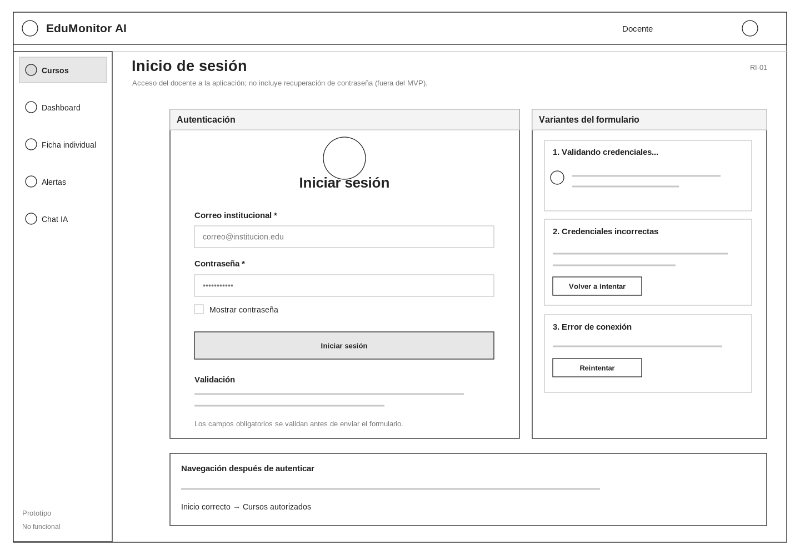
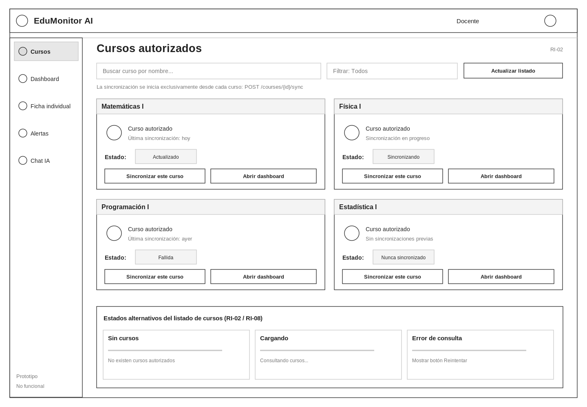
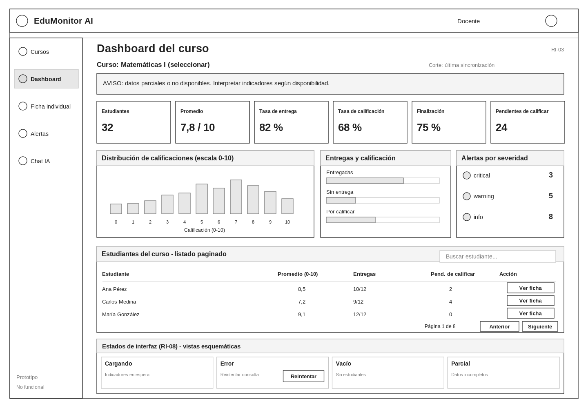
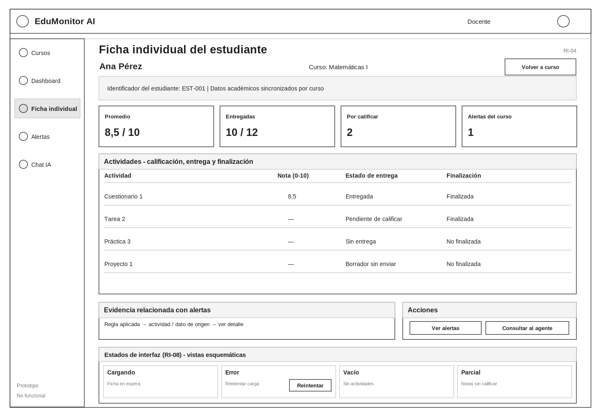
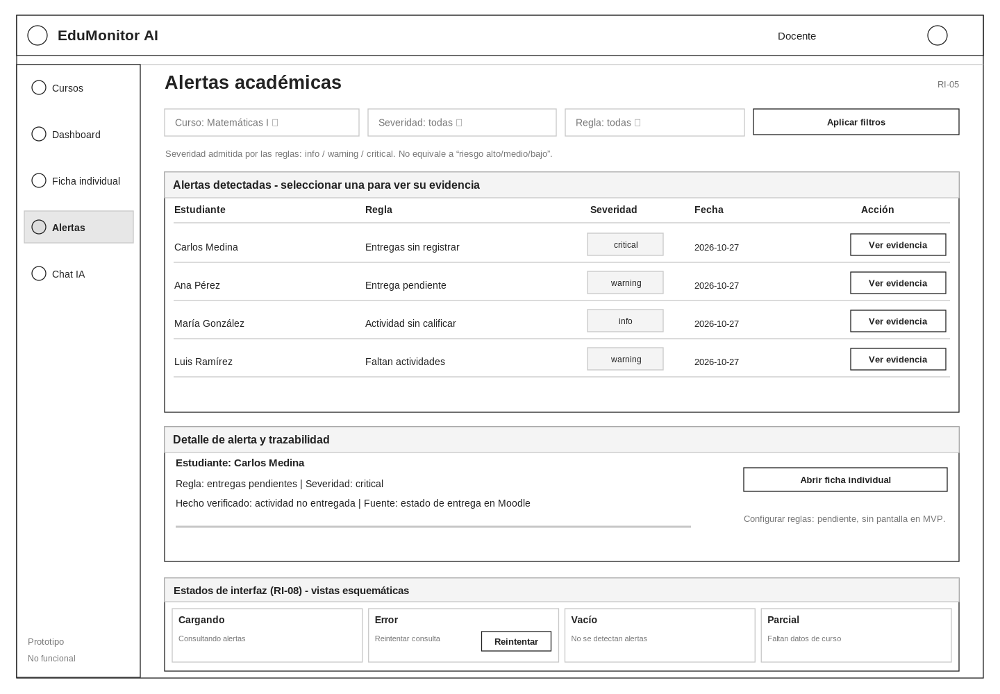
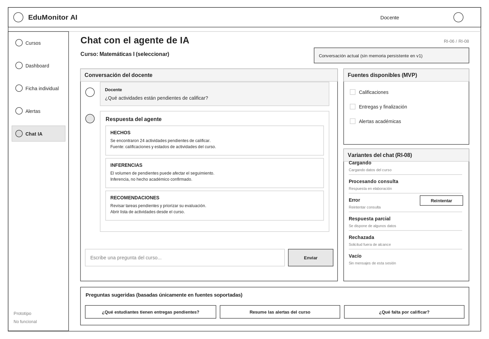

# Wireframes de baja fidelidad — EduMonitor AI

**Tarea:** S1-13
**Sprint:** 1
**Responsable:** Benjamín (@99benjaminb)
**Estado:** propuesta corregida, pendiente de nueva revisión

## 1. Objetivo y alcance

Este directorio documenta seis wireframes **low-fidelity** de EduMonitor AI, enfocados en jerarquía visual, navegación, componentes y estados funcionales del **MVP**. No constituyen prototipos ejecutables, datos reales, ni una definición de estilo final. Los valores, nombres de personas y cantidades en las pantallas son **ilustrativos**.

El criterio de inclusión es respetar los requisitos `docs/requirements/requisitos.md` y los contratos API vigentes. Se retiraron controles o datos sin respaldo contractual, de acuerdo con la revisión de la Pull Request #19. Los diagramas muestran situaciones normales y variantes de carga, error, datos vacíos o parciales.

## 2. Pantallas y trazabilidad

| Archivo | Pantalla | Requisito principal | Estados/transversales |
|---|---|---|---|
| [01-login.png](01-login.png) | Autenticación del docente | RI-01 | Validación, autenticando y error |
| [02-cursos.png](02-cursos.png) | Cursos autorizados y sincronización por curso | RI-02 | Sincronizando, fallida, nunca sincronizado; vacío/error |
| [03-dashboard.png](03-dashboard.png) | Dashboard académico | RI-03 | RI-08: carga, error, vacío y datos parciales |
| [04-ficha-estudiante.png](04-ficha-estudiante.png) | Ficha individual del estudiante | RI-04 | RI-08: carga, error, vacío y datos parciales |
| [05-alertas.png](05-alertas.png) | Alertas académicas con evidencias | RI-05 | RI-08: carga, error, vacío y datos parciales |
| [06-chat-ia.png](06-chat-ia.png) | Chat con agente de IA | RI-06 | RI-08: procesando, error/reintento, respuesta parcial/rechazada, vacío |

### 2.1 Inicio de sesión (RI-01)

Formulario con correo institucional, contraseña, mostrar contraseña, inicio de sesión y variantes de validación/autenticación. No se muestra «¿Olvidaste tu contraseña?» porque el MVP no define un endpoint de recuperación.

### 2.2 Cursos (RI-02)

Listado de cursos autorizados con búsqueda y filtro. Cada tarjeta permite **sincronizar ese curso**, en correspondencia con `POST /courses/{id}/sync`, y entrar a su dashboard. Se representan los estados de sincronización: actualizado, sincronizando, fallida y nunca sincronizado; también estados de listado vacío y error. No existe sincronización global.

### 2.3 Dashboard (RI-03)

Presenta promedio académico en escala **0–10**, número de estudiantes, tasa de entrega, tasa de calificación, tasa de finalización, actividades pendientes de calificar, distribución de notas **0–10**, alertas por severidad (`info`, `warning`, `critical`) y tabla de estudiantes **paginada**. Incluye aviso de datos parciales/no disponibles y estados de carga, error y vacío.

### 2.4 Ficha individual (RI-04)

Muestra calificaciones por actividad, **estado de entrega** y **estado de finalización** de cada actividad. Se ejemplifican expresamente las etiquetas **Pendiente de calificar**, **Sin entrega** y **Borrador sin enviar**. Se evita inferir un «estado general» o niveles de riesgo no definidos por las reglas.

### 2.5 Alertas académicas (RI-05)

Permite filtrar y consultar alertas por curso, regla y **severidad** (`info`, `warning`, `critical`), con panel de evidencia y trazabilidad de la información usada. No se dibuja un editor de reglas: **«Configurar reglas» está pendiente y no cuenta con pantalla ni endpoint en el MVP**.

### 2.6 Chat con el agente (RI-06)

La respuesta se estructura en **Hechos**, **Inferencias** y **Recomendaciones**, diferenciando datos de conclusiones y acciones sugeridas. Se presentan como fuentes **calificaciones, entregas/finalización y alertas académicas**. Se excluyen fuentes no contratadas: foros, registros de acceso y contenido del curso. El chat muestra únicamente la conversación de la sesión ilustrada; **no se presupone memoria persistente del agente en v1**. Se incorporan «Procesando consulta», error con reintento, respuesta parcial y solicitud rechazada.

## 3. Criterios de fidelidad y datos permitidos

- Blanco, negro y escala de grises; líneas simples y contenedores rectangulares.
- Elementos esquemáticos y estáticos: no se presupone implementación funcional.
- Imágenes referenciales, mapas y medios no aportan contenido adicional; no se simulan integraciones inexistentes.
- **Calificaciones siempre en escala 0–10.** Los niveles `info`, `warning` y `critical` describen **severidad de alertas**, no niveles de riesgo personal.
- Datos de ejemplo utilizados solo para explicar ubicación de elementos; no son registros de estudiantes reales.

## 4. Elementos expresamente excluidos del MVP

- Ficha: participación en clase, calidad de trabajos, trabajo en equipo, gestión del tiempo, matrícula, columna «Observación» y evolución por períodos.
- Dashboard y ficha: «Estado general» y clasificaciones de riesgo alto/medio/bajo.
- Chat: foros, registros de acceso, contenido de curso como fuentes; preguntas sugeridas basadas en participación; historial persistente de consultas.
- Login: recuperación de contraseña («¿Olvidaste tu contraseña?»).
- Cursos: botón de sincronización global.
- Alertas: control funcional «Configurar reglas» (pendiente de diseño y contrato).

## 5. Estados de interfaz — RI-08

Los wireframes indican variantes de **cargando, error con reintento, vacío y datos parciales/no disponibles** para dashboard, ficha, alertas y chat. En el chat se distingue adicionalmente **procesando consulta**, **respuesta parcial** y **respuesta rechazada**. Las variantes son vistas estructurales para diseño, no capturas de funciones implementadas.

## 6. Archivos y editabilidad

Las imágenes `.png` son los entregables de visualización en GitHub. Los archivos de `editables/` en formato `.svg` conservan geometrías y texto editable, para futuras revisiones sin depender de Figma.

## 7. Validación pendiente

- [x] Se diseñaron las seis pantallas previstas.
- [x] Se corrigió la correspondencia funcional señalada en la revisión de PR #19.
- [x] Se completó la documentación y la trazabilidad RI-01 a RI-06 y RI-08.
- [x] Se prepararon archivos PNG optimizados y fuentes SVG editables.
- [ ] Revisión de las correcciones por el equipo.
- [ ] Aceptación del Product Owner cuando corresponda.
- [ ] Integración en `develop` después de las aprobaciones.
